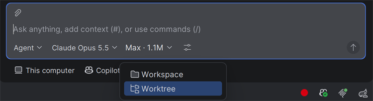

# Week 1: Fundamentals

**Two features at once** · Part 1 of 5 · [All weeks](../README.md)

Copilot can work on more than one task at a time. This week, you run two Copilot sessions side by side, each in its own copy of the code. Then Copilot helps with your own typing, by predicting your next edit.

## The problem

Trail Store needs two small features:

- **Search.** `/?q=boots` shows only the products whose name contains "boots", ignoring case.
- **Low stock.** A product with 1 to 5 left says "Only 4 left" instead of "4 in stock".

Build both at the same time, with two Copilot sessions that don't get in each other's way. Then make one change yourself:

- **Categories.** Each product shows its category on the page as `<p class="category">Jackets</p>`. The categories are Jackets, Boots, Packs or Tents.

## Use

### Parallel sessions and worktrees

A session is one conversation with Copilot, about one task. Click **+** at the top of Chat to start another one. Sessions run at the same time.

Two sessions in the same folder can trip over each other's changes. A git worktree solves that: it's a second folder with its own copy of the code, on its own branch, in the same repo. Pick **Worktree** in the row under the chat box, and the session gets its own worktree, starting from your last commit. When it's done, **Apply**, above the chat box, copies its changes into your project.



### Next edit suggestions

Completions finish the line you're typing. Next edit suggestions go further: after you change one line, Copilot suggests the edit that follows from it, even in another file. Press **Tab** to jump to it, and **Tab** again to accept it. You may need to type the first category in `Catalog.java` yourself, then press **Tab** to fill in the rest. Check it's on in Settings → GitHub Copilot → Completions.

## Get started

Open this repo in IntelliJ IDEA with the GitHub Copilot plugin, and run the tests:

```bash
cd 01-fundamentals
./mvnw -B -ntp verify
```

On Windows, use `.\mvnw.cmd -B -ntp verify`. `SearchTests`, `LowStockTests` and `CategoryTests` fail.

## Done when

- [ ] All the tests pass.
- [ ] Search and low stock each came from their own worktree session.
- [ ] You typed the categories yourself, with next edit suggestions.

Stuck? Read the [solution](SOLUTION.md).
