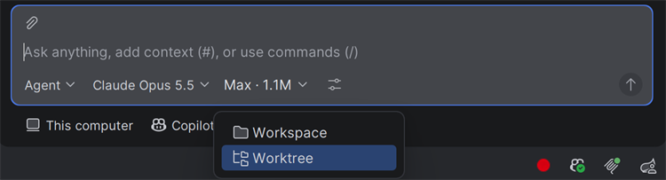
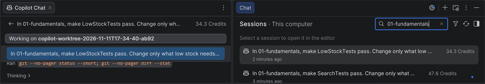
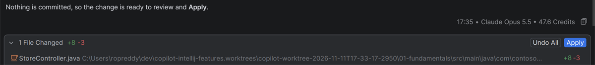
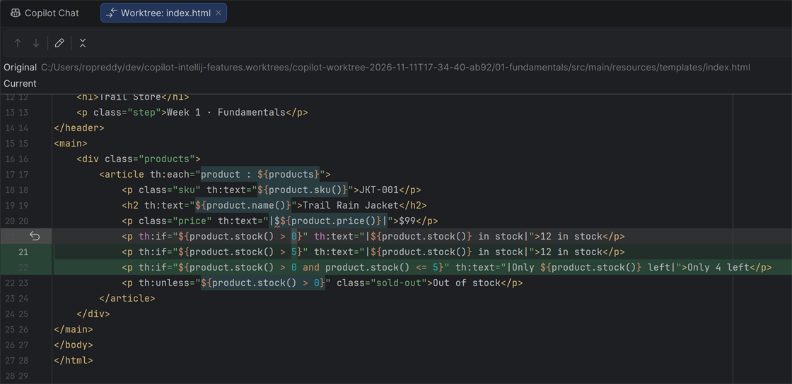
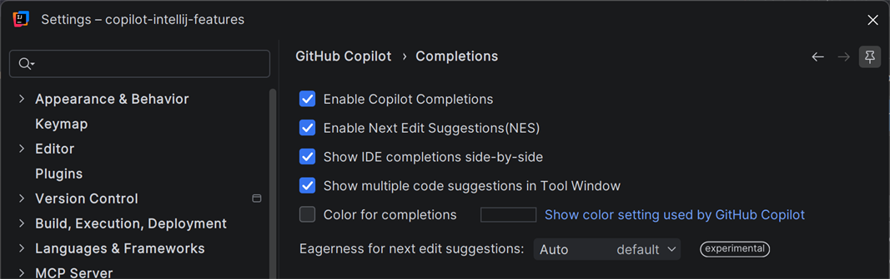
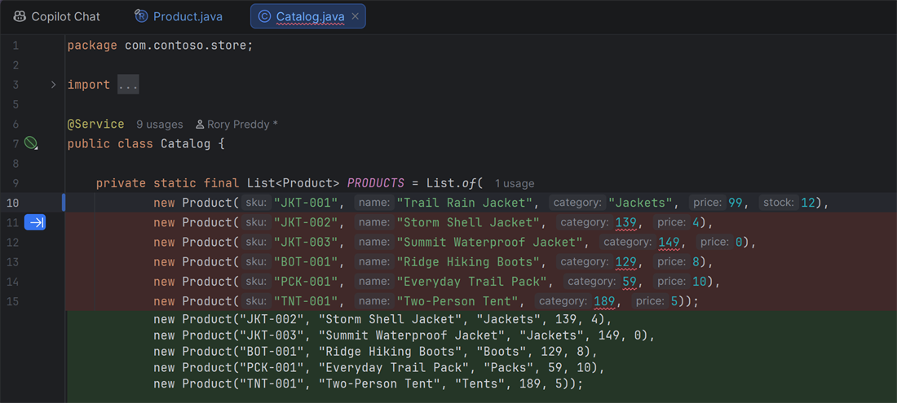
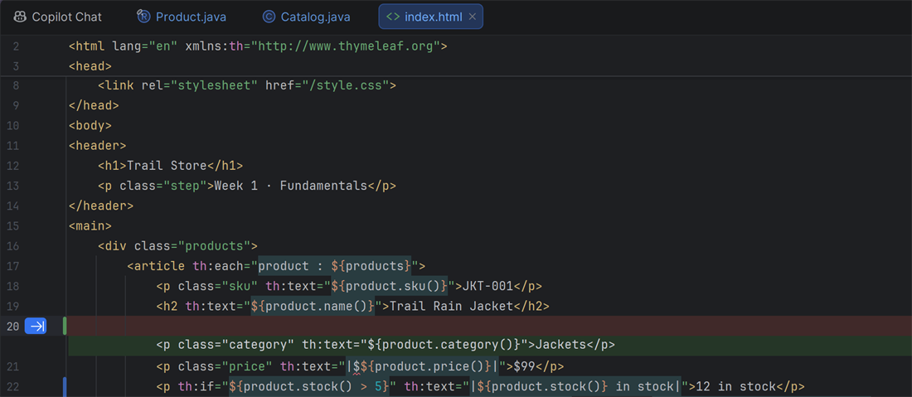
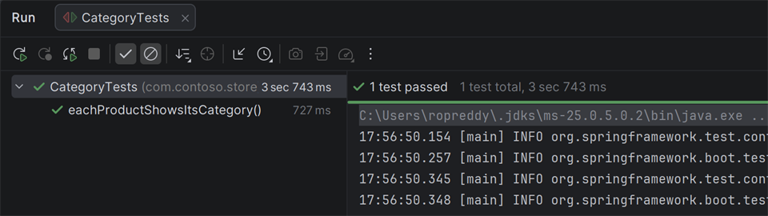

# Week 1 solution: Two features at once

How to solve [the challenge](README.md) with GitHub Copilot in IntelliJ IDEA.

## 1. Start two sessions, each in its own worktree

A worktree session starts from your last commit. If Copilot asks about uncommitted changes, choose **Skip Changes**.

1. At the top of Chat, click **+** to start a new session. In the row under the chat box, click **Workspace** and choose **Worktree**.

   

2. Send:

   > In 01-fundamentals, make SearchTests pass. Change only what search needs, and run SearchTests to check.

3. Click **+** to start a second session, also in **Worktree** mode, and send:

   > In 01-fundamentals, make LowStockTests pass. Change only what low stock needs, and run LowStockTests to check.

4. At the top of Chat, click **Show Sessions Side Bar**. The chat opens in an editor tab, with the **Sessions** list beside it. Click a session in the list to switch to it.

   

   *The line under the title names the session's worktree.*

## 2. Apply both sessions' changes

When a session finishes, the files it changed are listed above the chat box. Click a file to review the diff, then click **Apply** to copy the changes into your project. Then click the other session in the **Sessions** list and do the same.





*Clicking a file opens it in IntelliJ's diff viewer.*

## 3. Add categories with next edit suggestions

Do this after you apply both sessions. In Settings → GitHub Copilot → Completions, check that **Enable Next Edit Suggestions(NES)** is selected.



1. In `Product.java`, add a category after the name:

   ```java
   public record Product(String sku, String name, String category, int price, int stock) {
   ```

2. Copilot suggests the matching change in `Catalog.java`. Press **Tab** to jump there, then **Tab** to accept. Keep going until every product has a category.

   

   *Copilot suggests the remaining categories. The arrow in the gutter means Tab accepts.*

3. In `index.html`, add the category under the product's name:

   ```html
   <p class="category" th:text="${product.category()}">Jackets</p>
   ```

   

   *Copilot can suggest this line too. Press Tab to accept it.*

## 4. Run the tests

Run `./mvnw -B -ntp verify` again, or click the green run icon next to a test class. All the tests pass.



## What you used

- **GitHub Copilot:** worktree sessions, the **Sessions** side bar, **Apply**, next edit suggestions.
- **IntelliJ IDEA:** editor tabs, the diff viewer, the test runner.

## The code

Copilot's code may look different. That's fine, as long as the tests pass.

Search, in `StoreController.java`:

```java
import org.springframework.web.bind.annotation.RequestParam;

@GetMapping("/")
String home(@RequestParam(defaultValue = "") String q, Model model) {
    String query = q.toLowerCase();
    model.addAttribute("products", catalog.all().stream()
            .filter(product -> product.name().toLowerCase().contains(query))
            .toList());
    return "index";
}
```

Low stock, in `index.html`, in place of the "in stock" line:

```html
<p th:if="${product.stock() > 5}" th:text="|${product.stock()} in stock|">12 in stock</p>
<p th:if="${product.stock() > 0 and product.stock() <= 5}" th:text="|Only ${product.stock()} left|">Only 4 left</p>
```

Categories, in `Catalog.java`:

```java
new Product("JKT-001", "Trail Rain Jacket", "Jackets", 99, 12),
new Product("JKT-002", "Storm Shell Jacket", "Jackets", 139, 4),
new Product("JKT-003", "Summit Waterproof Jacket", "Jackets", 149, 0),
new Product("BOT-001", "Ridge Hiking Boots", "Boots", 129, 8),
new Product("PCK-001", "Everyday Trail Pack", "Packs", 59, 10),
new Product("TNT-001", "Two-Person Tent", "Tents", 189, 5));
```
