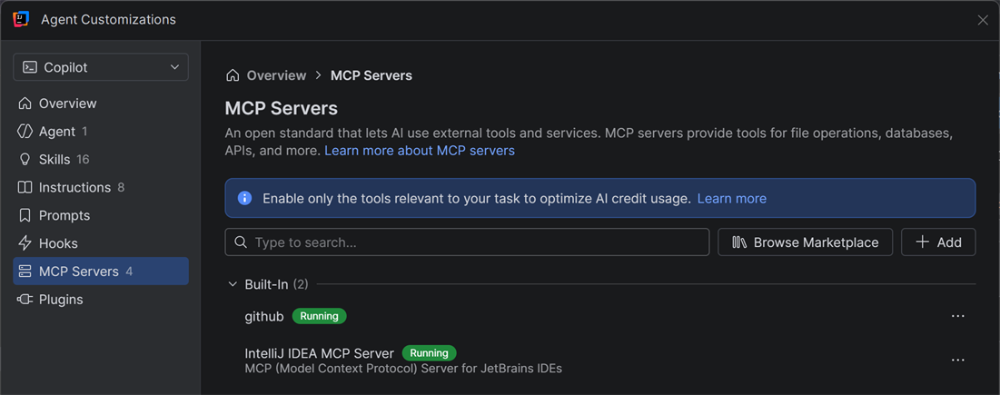

# Week 2: Tooling

**Free jackets** · Part 2 of 5 · [All weeks](../README.md)

Copilot works better when it knows your project and can use your tools. This week, you customize Copilot, and connect it to IntelliJ's own tools.

## The problem

It's sale week: every jacket is 20% off. But the store sells the jackets for $0.

Find the bug and fix it. Copilot does the work with IntelliJ's own test runner, debugger and refactorings.

Also set up Copilot for this workspace, and rename one method:

- Install the **java-development** plugin.
- Create a **bug-hunter** custom agent and a **run-the-store** skill, for the workspace.
- Rename `all()` in `Catalog.java` to `products()`, with IntelliJ's rename refactoring. If you do the rename yourself with **Shift+F6**, untick **Search in comments and strings** and **Search for text occurrences**, so the change stays in this week's folder.

## Use

### Customization panel

**Customizations**, at the top of Chat, is where you shape what Copilot knows and can do:

- A **plugin** is a ready-made bundle, such as prompts, instructions and agents, from a marketplace.
- A **custom agent** is Copilot with your own instructions for one kind of job. You pick it in the **Agent** selector in the chat box. A new agent may not show there until you restart IntelliJ.
- A **skill** teaches Copilot one task, such as how to run the store. Copilot reads it when the task comes up.

The agents and skills you create for the workspace are files in `.github/`, so everyone who clones the repo gets them.

### Built-in MCP server

MCP, the Model Context Protocol, is an open standard that lets AI use tools from other programs. IntelliJ has its own MCP server, so Copilot can use IntelliJ's test runner, debugger and rename refactoring, not just the terminal. Turn it on in Settings → AI → MCP Server.



### Browser use, optional

Copilot opens pages in your own browser and reads them, so it can check a change in the running app. It's a preview. Turn it on in Settings → GitHub Copilot → Chat → Agent. It needs Node.js 22 or later, and Chrome or Edge with the GitHub Copilot browser extension.

## Get started

Copilot uses IntelliJ's test runner and debugger this week, so set up the project in IntelliJ first:

- If the **Maven** tool window is empty, right-click the `pom.xml` at the top of the repo, and choose **Add as Maven Project**.
- In File → Project Structure → Project, set **SDK** to JDK 25.

Then run the tests:

```bash
cd 02-tooling
./mvnw -B -ntp verify
```

On Windows, use `.\mvnw.cmd -B -ntp verify`. `SaleTests` fails: the jackets should cost $79, $111 and $119.

## Done when

- [ ] All the tests pass.
- [ ] Copilot found the bug in IntelliJ's debugger.
- [ ] `all()` in `Catalog.java` is renamed to `products()`, by IntelliJ's rename refactoring.
- [ ] Customizations lists your plugin, agent and skill.

Stuck? Read the [solution](SOLUTION.md).
