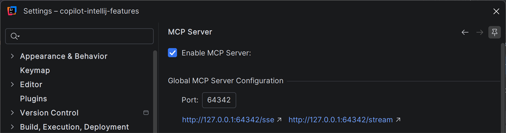
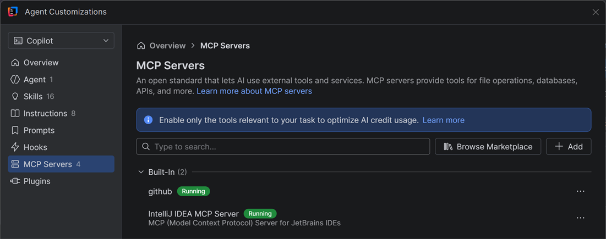
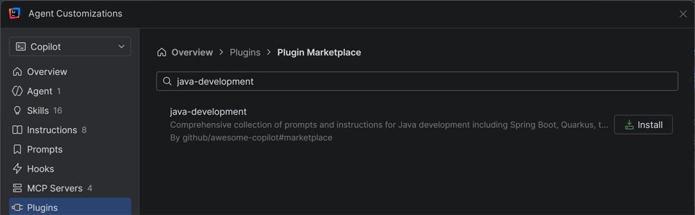
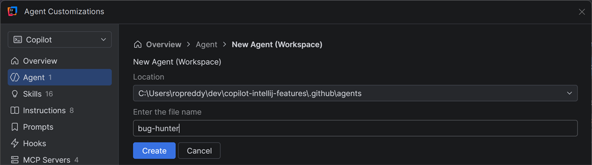
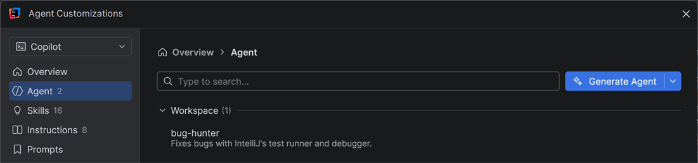
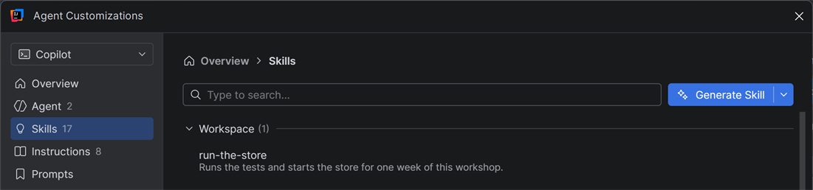
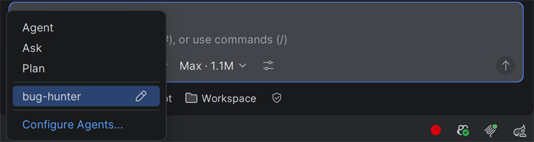
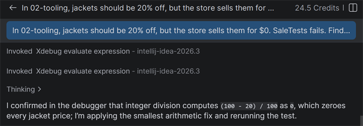
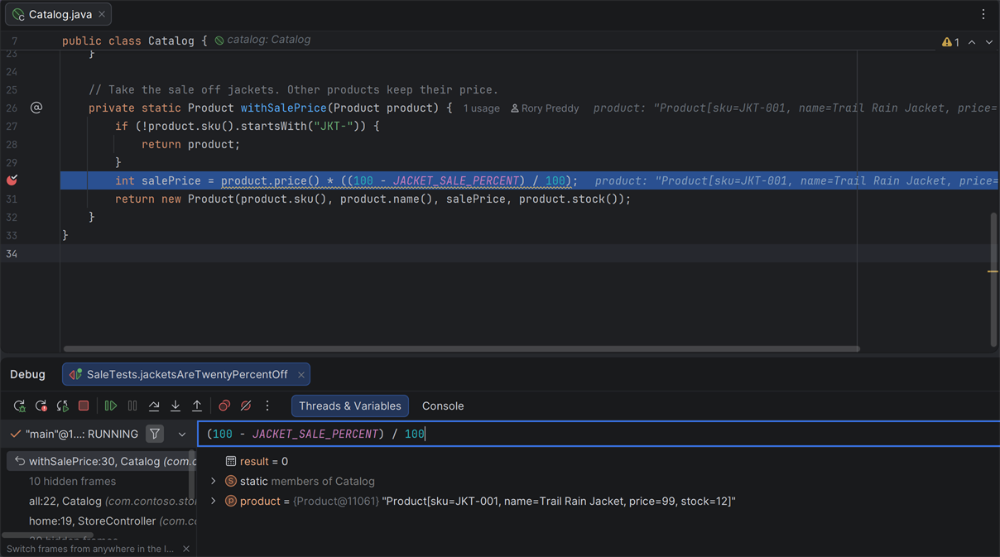
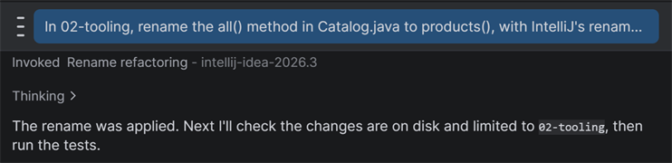

# Week 2 solution: Free jackets

How to solve [the challenge](README.md) with GitHub Copilot in IntelliJ IDEA.

## 1. Turn on IntelliJ's MCP server

In Settings → MCP Server (in some versions, under AI), select **Enable MCP Server**, and click **OK**. If you don't see it, search Settings for MCP Server. Copilot can now use IntelliJ's tools. In **Customizations**, at the top of Chat, **MCP Servers** lists **IntelliJ IDEA MCP Server** as **Running**.





## 2. Fill the Customization panel

Open **Customizations** at the top of Chat.

1. **Plugin.** Under **Plugins**, click **Browse Marketplace**, search for `java-development`, and click **Install**.

   

2. **Custom agent.** On the left, click **Agent**. Click the arrow next to **Generate Agent**, choose **New Agent (Workspace)**, enter `bug-hunter`, and click **Create**. This creates `.github/agents/bug-hunter.agent.md`. Replace all of its text, including `tools: []`, with:

   ```markdown
   ---
   description: Fixes bugs with IntelliJ's test runner and debugger.
   ---
   Fix bugs with evidence:
   1. Run the failing test with IntelliJ's test runner.
   2. Debug the test in IntelliJ, and read the variables at a breakpoint.
   3. Explain the cause in one sentence, make the smallest fix, and run the test again.
   ```

   

   

   *Once you save the file, bug-hunter is listed under Workspace, with its description. If it isn't listed in the **Agent** selector, restart IntelliJ.*

3. **Skill.** On the left, click **Skills**. Click the arrow next to **Generate Skill**, choose **New Skill (Workspace)**, enter `run-the-store`, and click **Create**. This creates `.github/skills/run-the-store/SKILL.md`. Replace all of its text with:

   ```markdown
   ---
   name: run-the-store
   description: Runs the tests and starts the store for one week of this workshop.
   ---
   Each week is its own app, in its own folder, like 02-tooling.
   Run the tests with ./mvnw -B -ntp verify (on Windows, .\mvnw.cmd -B -ntp verify).
   Start the store with ./mvnw spring-boot:run, and open http://localhost:8080.
   ```

   

## 3. Find the bug

Start a new session. If the row under the chat box still says **Worktree** from week 1, click it and choose **Workspace**. Then, in the chat box, pick **bug-hunter** in the **Agent** selector. If it isn't there, restart IntelliJ, then pick it, and send:

> In 02-tooling, jackets should be 20% off, but the store sells them for $0. SaleTests fails. Find out why and fix it.



Before Copilot runs a terminal command, a **Confirm Command Execution** dialog appears. Check the command, and confirm it.

Copilot runs `SaleTests`, sets a breakpoint in `Catalog.withSalePrice()` and debugs the test. While the test is paused, IntelliJ's debugger shows the bug: `(100 - JACKET_SALE_PERCENT) / 100` is `0`. In Java, dividing two whole numbers drops the fraction, so 80 / 100 is 0.



*Each debugger call names IntelliJ's MCP server, `intellij-idea-2026.3`.*



*IntelliJ's debugger, paused in `withSalePrice()` for the Trail Rain Jacket.*

The fix multiplies first, then divides:

```java
int salePrice = product.price() * (100 - JACKET_SALE_PERCENT) / 100;
```

## 4. Rename with IntelliJ

Send:

> In 02-tooling, rename the all() method in Catalog.java to products(), with IntelliJ's rename refactoring. Rename code only, without searching comments and text. Change only files in 02-tooling.

IntelliJ renames the method and every call to it. If you rename it yourself with **Shift+F6**, untick **Search in comments and strings** and **Search for text occurrences**, or the rename also changes text in other weeks.



## 5. Check the page in a browser (optional)

Browser use is a preview in version 1.21.1. It needs Node.js 22 or later, and Chrome or Edge with the **GitHub Copilot** browser extension. The extension's getting-started page covers only Copilot CLI. For IntelliJ, follow these steps:

1. Turn on Settings → GitHub Copilot → Chat → Agent → **Enable Browser Use**, and click **OK**.
2. In 02-tooling, start the store with `./mvnw spring-boot:run` (on Windows, `.\mvnw.cmd spring-boot:run`).
3. In a new session, send:

   > Open http://localhost:8080 and tell me the price of each jacket.

   A permission prompt appears for each site Copilot opens: allow it. The browser also shows a banner that it's being debugged. That's expected.

Copilot doesn't fall back to another way to open the page. If you don't have browser use, or no browser is connected, open <http://localhost:8080> yourself.

## What you used

- **GitHub Copilot:** the Customization panel (plugin, custom agent, skill), the agent selector, browser use.
- **IntelliJ IDEA:** the MCP server, the test runner, the debugger, rename refactoring.

## The code

The whole fix is one line in `Catalog.java`:

```diff
-        int salePrice = product.price() * ((100 - JACKET_SALE_PERCENT) / 100);
+        int salePrice = product.price() * (100 - JACKET_SALE_PERCENT) / 100;
```

The rename changes `all()` to `products()` in `Catalog.java` and `StoreController.java`. No other files change.
