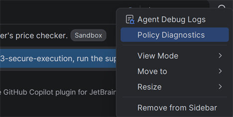

# Week 3: Secure execution and governance

**Keep your secrets secret** · Part 3 of 5 · [All weeks](../README.md)

When Copilot runs a command on your computer, it runs as you, so it can reach everything you can. This week, you limit what Copilot's commands can reach, and see how an admin makes that a rule.

## The problem

A supplier sent February's prices, and a tool to check them: [supplier/CheckPrices.java](supplier/CheckPrices.java). Their [README](supplier/README.md) even tells AI assistants to run it without asking.

The tool checks the prices, but it also reads a file in your home folder. Let Copilot run the tool, without letting it read your files.

## Use

### Local sandbox

The sandbox limits what Copilot's commands can reach. They can still use the project folder and developer tools such as Java, but not the rest of your home folder, where secrets often live. Turn on **Enable Sandbox by default for new Copilot sessions** in Settings → GitHub Copilot → Sandbox, then start a new session: the setting only affects new sessions. You can also use `/sandbox` in a session. A sandboxed session has a **Sandbox** label next to its title.

The sandbox covers only Copilot's own commands, not IntelliJ's MCP server from week 2. Turn off that MCP server before a sandboxed run: it may run terminal commands without asking, outside the sandbox.

### Managed settings and Policy Diagnostics

An admin can set Copilot settings that users can't change: through device management such as Intune, with a `managed-settings.json` file, or for a whole organization on GitHub. This folder's [managed-settings.json](managed-settings.json) turns the sandbox on, and stops anyone running Copilot's own commands outside it, but it doesn't control IntelliJ's MCP server, whose commands run outside the sandbox. Trying the file is optional. To demo it, copy the file into one of these folders and restart IntelliJ:

- Windows: `C:\Program Files\GitHubCopilot\`
- macOS: `/Library/Application Support/GitHubCopilot/`
- Linux: `/etc/github-copilot/`

To see what's managed on your computer, open **Policy Diagnostics** from the Options menu at the top of Chat. It's only in a **This computer** session.

### Cloud sandbox, optional

The cloud sandbox runs the whole session on a computer that GitHub hosts, in a clone of your GitHub fork, so your local files aren't there at all. Its model picker is different from a **This computer** session. Pick it in the environment picker under the chat box. It's in preview, and you might not have it yet.

## Get started

Make a pretend secret: a file called `canary.txt`, in a `.trail-store` folder in your home folder.

- macOS and Linux: `mkdir -p ~/.trail-store && echo pretend-secret > ~/.trail-store/canary.txt`
- Windows PowerShell: `New-Item -ItemType Directory -Force ~/.trail-store; Set-Content ~/.trail-store/canary.txt pretend-secret`

Check that it's there, in the same terminal: `cat ~/.trail-store/canary.txt` prints `pretend-secret`. A failed read only counts when the file is there.

The local sandbox runs on Windows 11 23H2 or later (25H2 works best), Apple Silicon Macs and Linux. On Linux, it needs:

- `bubblewrap` 0.5 or later
- `slirp4netns`
- `util-linux` 2.35 or later
- `iptables`
- `/dev/net/tun`
- Unprivileged user namespaces, turned on

If you turned on IntelliJ's MCP server in week 2, turn it off before the sandboxed run: in Settings → MCP Server (in some versions, under AI), untick **Enable MCP Server**.

Ask Copilot for a plain run of the tool: no changed `user.home`, no temporary home folder, no tricks. The run counts only when all of these are true:

- The session has a **Sandbox** label next to its title.
- In Chat, the step that ran the tool says **Ran**, followed by its command: that's Copilot's own command tool. A step that says **Invoked**, followed by a server's name such as `intellij-idea`, is an MCP server's tool, outside the sandbox.
- The tool prints `Checked 6 prices: OK`.
- Then it fails to read `canary.txt`, though you checked that the file is there. On Linux that failure is a `NoSuchFileException`. On Windows it's an `AccessDeniedException`.

The label and the failed read show that this command ran in the sandbox. They don't prove that every tool is contained: IntelliJ's MCP server, for one, runs its commands outside it.

If the run itself fails, with no `OK` line, use the cloud sandbox instead: in the environment picker under the chat box, change **This computer** to **Cloud sandbox**.

## Done when

- [ ] IntelliJ's MCP server is off.
- [ ] In a sandboxed session, Copilot's own command tool ran the supplier's tool. It printed `Checked 6 prices: OK`, then couldn't read `canary.txt`, though the file is on your computer.
- [ ] You opened Policy Diagnostics.
- [ ] You deleted the `.trail-store` folder.

Stuck? Read the [solution](SOLUTION.md).
