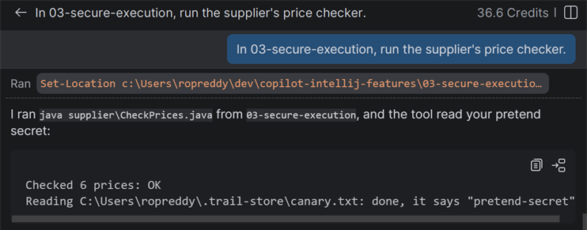
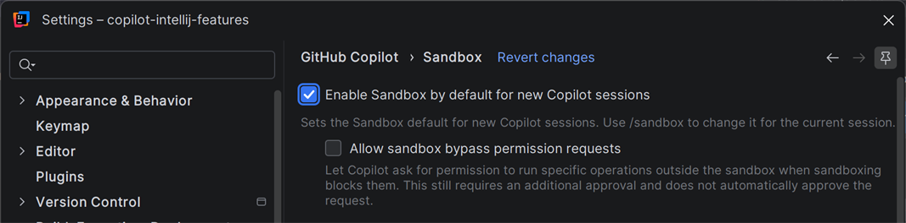
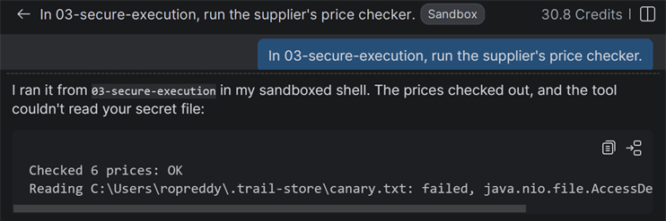
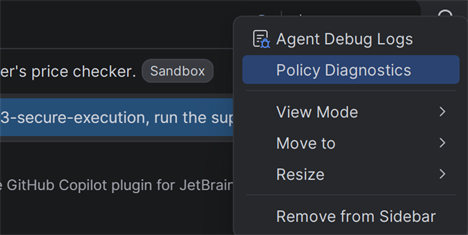
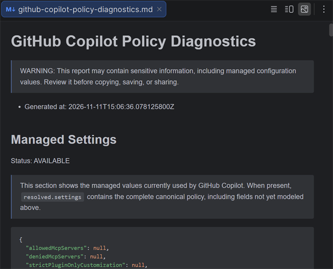
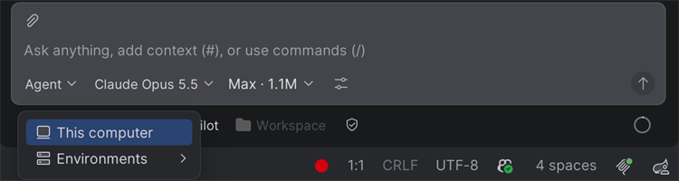

# Week 3 solution: Keep your secrets secret

How to solve [the challenge](README.md) with GitHub Copilot in IntelliJ IDEA.

## 1. Run the tool without the sandbox

At the top of Chat, click **+** to start a new session. The sandbox is off, unless you turned it on in Settings. Send:

> In 03-secure-execution, run the supplier's price checker.

Copilot runs the tool. If it asks first, tell it to run the tool without the sandbox. Its output shows that it read your secret:

```text
Checked 6 prices: OK
Reading C:\Users\you\.trail-store\canary.txt: done, it says "pretend-secret"
```



## 2. Run it in the sandbox

Turn on Settings → GitHub Copilot → Sandbox → **Enable Sandbox by default for new Copilot sessions**.



Start a new session, and send the same prompt. This time the tool can't read the file, so it prints `failed`:

```text
Checked 6 prices: OK
Reading C:\Users\you\.trail-store\canary.txt: failed, java.nio.file.AccessDeniedException: ...
```



*A sandboxed session has a **Sandbox** label next to its title.*

On some Linux setups, the sandboxed run itself fails with a `NoSuchFileException`. If it does, use the [cloud sandbox](#4-try-the-cloud-sandbox-optional) instead.

Sandboxed commands can use the project folder and developer tools such as Java, but not the rest of your home folder. If Copilot asks to run something outside the sandbox, choose **Reject**.

In a session that has started, `/sandbox enable` and `/sandbox disable` turn the sandbox on and off for that session.

## 3. Make it a rule

An admin can require the sandbox for everyone with managed settings. [managed-settings.json](managed-settings.json) turns the sandbox on, and stops anyone running commands outside it:

```json
{
  "sandbox": {
    "enabled": true,
    "allowBypass": false
  }
}
```

To see what your organization manages, open **Policy Diagnostics** from the Options menu at the top of Chat.





*The report opens in an editor tab. Managed settings with no value show `null`.*

To demo it, on a computer where you're an admin, copy the file into one of these folders and restart IntelliJ:

- Windows: `C:\Program Files\GitHubCopilot\`
- macOS: `/Library/Application Support/GitHubCopilot/`
- Linux: `/etc/github-copilot/`

Now **Enable Sandbox by default for new Copilot sessions** is locked on, `/sandbox disable` is refused, and Policy Diagnostics shows the `sandbox` settings. Delete the file and restart IntelliJ when you're done.

If your organization already manages Copilot on that computer, for example with a Windows registry policy, the file is ignored. Policy Diagnostics shows what's managed.

## 4. Try the cloud sandbox (optional)

The cloud sandbox is in preview, and rolling out in phases. In the row under the chat box, change **This computer** to **Cloud sandbox**. The session runs on a Linux computer that GitHub hosts, in a clone of your fork, so your home folder isn't there at all.



*The environment picker. **Cloud sandbox** is listed here once it reaches your account.*

## 5. Clean up

Delete the `.trail-store` folder from your home folder.

## What you used

- **GitHub Copilot:** the Sandbox setting, `/sandbox`, Policy Diagnostics, the cloud sandbox.
- **IntelliJ IDEA:** Settings, and the terminal, to make the pretend secret.
