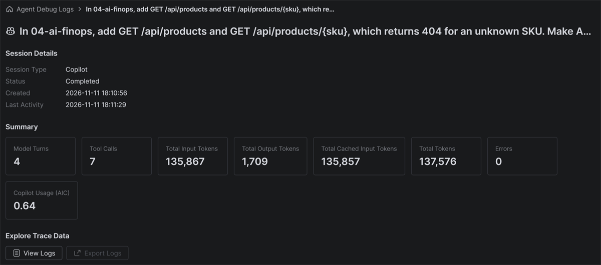

# Week 4: AI FinOps

**What does a task cost?** · Part 4 of 5 · [All weeks](../README.md)

Every Copilot task has a cost, counted in AI credits. This week, you measure what one task costs, and see how one setting changes it.

## The problem

Your manager asks what a Copilot task costs. Find out: give Copilot the same small task twice, once with Fusion **Standard** and once with Fusion **Max**, each in its own **Worktree** session, and compare. Don't apply the first run until you've finished the second, then apply only the Max run, so the second run doesn't start with the first run's code. Tell Copilot not to change the tests.

The task is a JSON API for the store:

- `GET /api/products` returns all six products.
- `GET /api/products/{sku}` returns one product, or 404 when there's no such product.

## Use

### Copilot Fusion

With Fusion, you don't pick a model. You pick an effort level, and Copilot picks the models. The picker shows **Standard**, **High** and **Max**. This week you compare Standard and Max. Max can use stronger models, and more than one per task, so it usually costs more. Turn on **Fusion** in the model picker, in the chat box. It's still rolling out, and Max isn't in every plan. If Max isn't in yours, compare Fusion Standard with a single model you pick: turn Fusion off, and choose a model.

### Agent debug logs

Models read and write text in tokens, which are small pieces of words. The more tokens a task uses, the more it costs, and each turn sends the whole conversation to the model again. Agent debug logs show what each session used. Open them from the Options menu at the top of Chat, and copy these fields from the **Summary** into [cost-report.md](cost-report.md): **Model Turns**, **Tool Calls**, **Total Tokens** and **Copilot Usage (AIC)**.



### OpenTelemetry, optional

OpenTelemetry is an open standard for traces: records of what a program did, step by step, and how long each step took. Copilot can send a trace of each session to a viewer, such as the Aspire dashboard. It needs Docker, installed and running. Start the viewer with [observability/docker-compose.yml](observability/docker-compose.yml), and turn on the export in Settings → GitHub Copilot → Chat.

## Get started

Run the tests:

```bash
cd 04-ai-finops
./mvnw -B -ntp verify
```

On Windows, use `.\mvnw.cmd -B -ntp verify`. `ApiTests` fails.

## Done when

- [ ] All the tests pass.
- [ ] [cost-report.md](cost-report.md) has the numbers for both runs.
- [ ] You can say which run cost more, and why.

Stuck? Read the [solution](SOLUTION.md).
