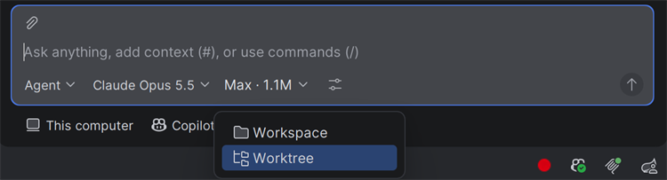
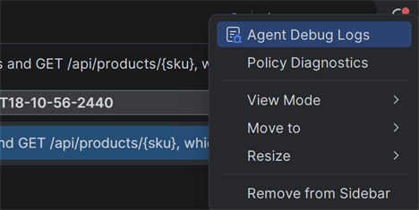
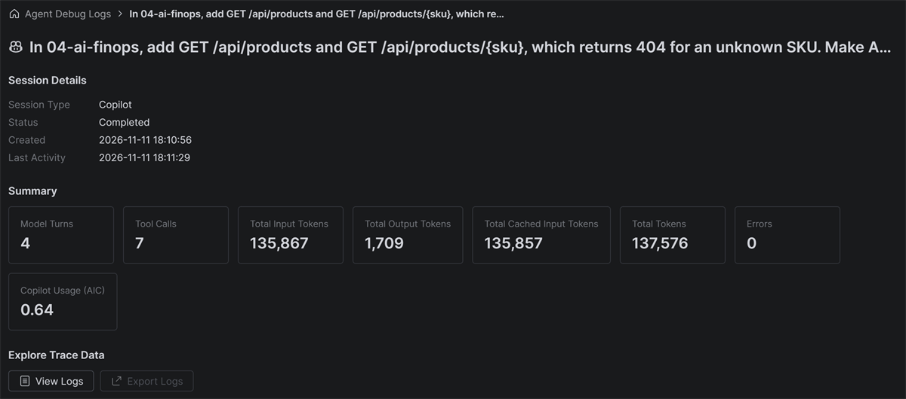
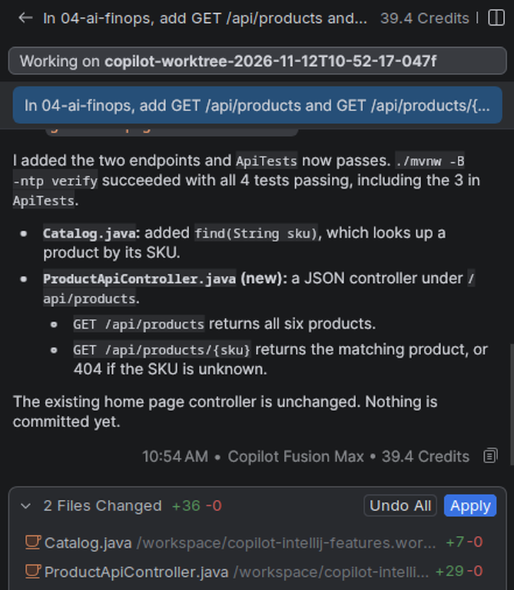
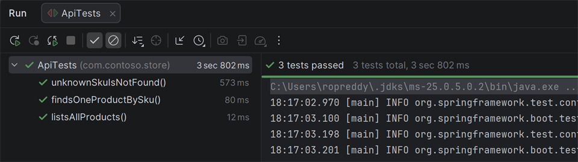
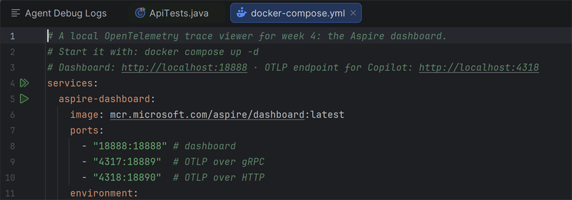
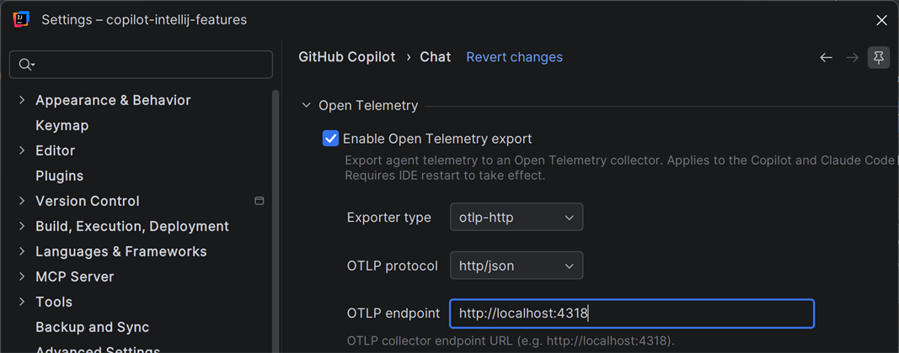

# Week 4 solution: What does a task cost?

How to solve [the challenge](README.md) with GitHub Copilot in IntelliJ IDEA.

## 1. Run 1: Standard effort

Each run starts in a new worktree, from your last commit, so both start from the same code. If Copilot asks about uncommitted changes, choose **Skip Changes**.

1. At the top of Chat, click **+** to start a new session. In the row under the chat box, click **Workspace** and choose **Worktree**.

   

2. Open the model picker in the chat box, turn on **Fusion**, and choose **Standard**.

   

   *Copilot Fusion in the model picker, from the GitHub Changelog. Fusion hadn't reached this account yet.*

3. Send:

   > In 04-ai-finops, add GET /api/products and GET /api/products/{sku}, which returns 404 for an unknown SKU. Make ApiTests pass.

## 2. Read the cost

When Copilot is done, open **Agent Debug Logs** from the Options menu at the top of Chat, and pick the newest session. Copy these numbers from its **Summary** into [cost-report.md](cost-report.md): **Model Turns**, **Tool Calls**, **Total Tokens** and **Copilot Usage (AIC)**.

Below Copilot's answer, the chat footer shows **Credits**. That's the same unit as **Copilot Usage (AIC)**: AI credits.





*The Summary of one run. It used Claude Haiku 5.5, because Fusion hadn't reached this account yet.*

## 3. Run 2: Max effort

Start another new session in **Worktree** mode. Choose Fusion **Max** in the model picker, send the same prompt, and record its numbers.

Fusion Max isn't in every Copilot plan. If you can't choose it, compare a small model and a large model instead.

## 4. Keep one run

Open the session you want to keep. Above the chat box, it lists every file it changed, such as a new controller and `Catalog.java`. Click **Apply** to copy them all into your project.



*Copilot's changes vary from run to run, so your file names might differ.*

If an **Uncommitted Changes** card appears, for example because of your numbers in `cost-report.md`, it offers **Copy**, **Move**, **Skip** and **Cancel**. Choose **Skip**.

Then run `./mvnw -B -ntp verify` again, or click the green run icon next to `ApiTests`. The tests pass.



## 5. Compare

Max can use stronger models, and more than one model for a task, such as one that writes the code and others that check it. So it usually costs more. Each turn sends the whole conversation to the model again, so the token count grows quickly. To see which models Fusion used, hover over the effort level below Copilot's answer.

## 6. See the traces (optional)

This needs Docker, installed and running.

1. Open `observability/docker-compose.yml`, and click the run icon next to `services:`. In the **Edit Run Configuration** dialog that opens, click **Run**. Or run `docker compose up -d` in the `observability` folder.

   

2. In Settings → GitHub Copilot → Chat, turn on **Enable Open Telemetry export**, set **OTLP endpoint** to `http://localhost:4318`, and restart IntelliJ.

   

3. Run a session, then open the Aspire dashboard at <http://localhost:18888>, and choose **Traces**. In a trace, the `execute_tool` spans show hashed tool names, not readable ones.

When you're done, stop the dashboard with `docker compose down`, and turn off the export.

## What you used

- **GitHub Copilot:** Copilot Fusion, worktree sessions, **Apply**, Agent Debug Logs, OpenTelemetry export.
- **IntelliJ IDEA:** running `docker-compose.yml` from the editor, the test runner.

## The code

Copilot's code may look different. That's fine, as long as the tests pass.

`ProductApiController.java`, next to `Catalog.java`:

```java
package com.contoso.store;

import java.util.List;
import org.springframework.http.ResponseEntity;
import org.springframework.web.bind.annotation.GetMapping;
import org.springframework.web.bind.annotation.PathVariable;
import org.springframework.web.bind.annotation.RequestMapping;
import org.springframework.web.bind.annotation.RestController;

@RestController
@RequestMapping("/api/products")
class ProductApiController {

    private final Catalog catalog;

    ProductApiController(Catalog catalog) {
        this.catalog = catalog;
    }

    @GetMapping
    List<Product> all() {
        return catalog.all();
    }

    @GetMapping("/{sku}")
    ResponseEntity<Product> one(@PathVariable String sku) {
        return ResponseEntity.of(catalog.all().stream()
                .filter(product -> product.sku().equals(sku))
                .findFirst());
    }
}
```
