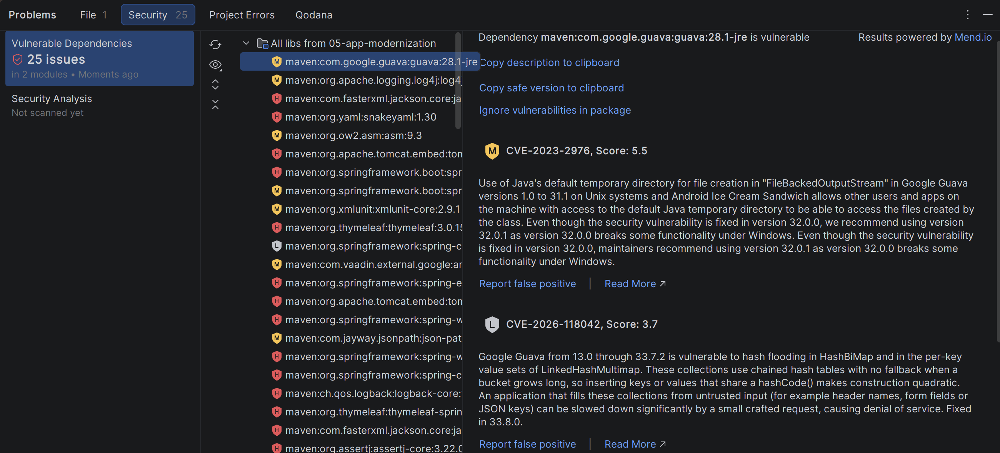
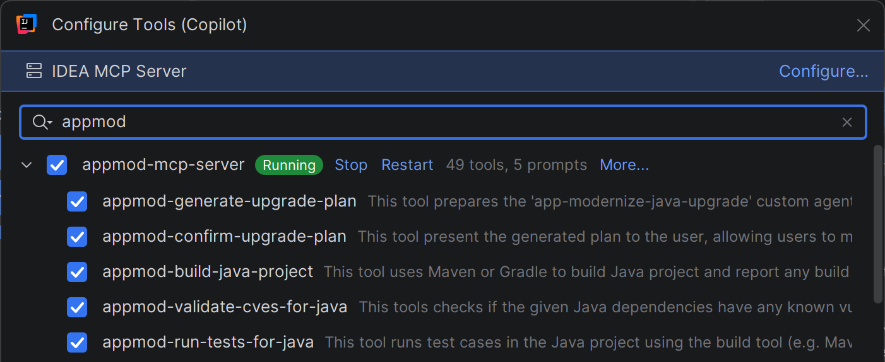
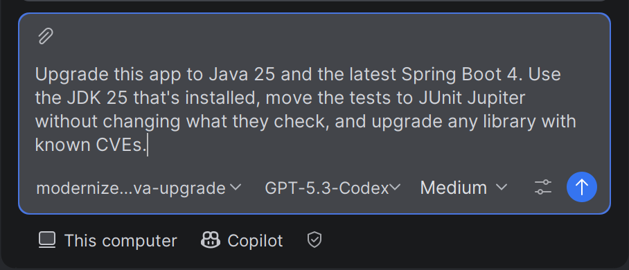
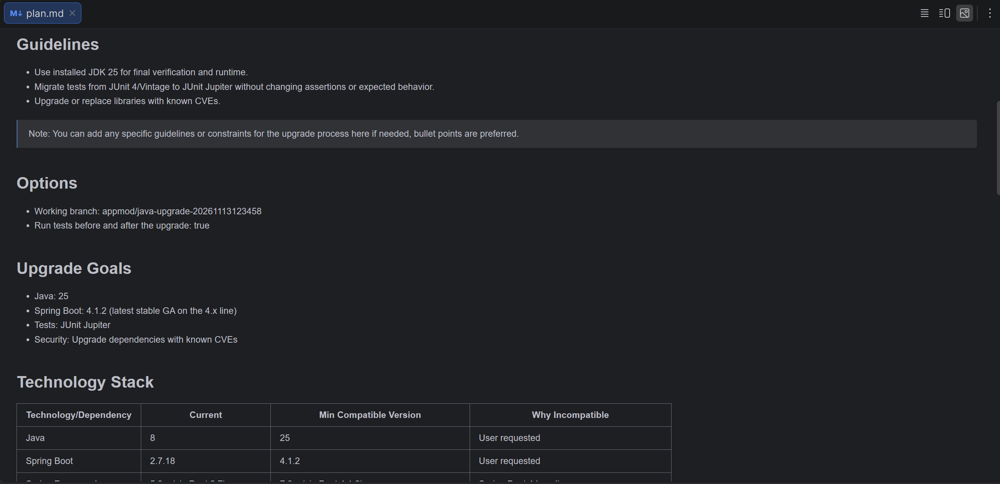
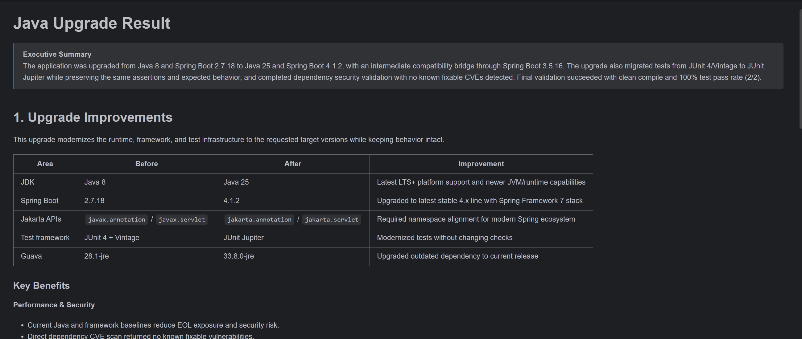
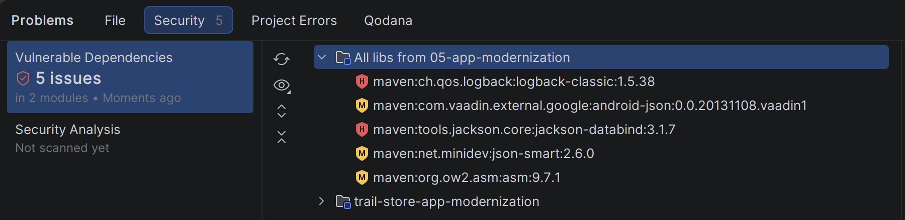
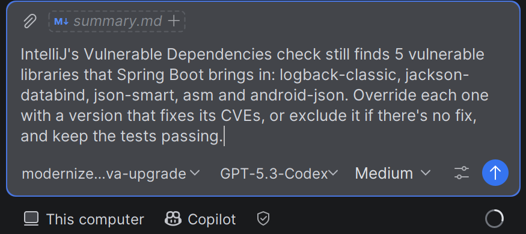
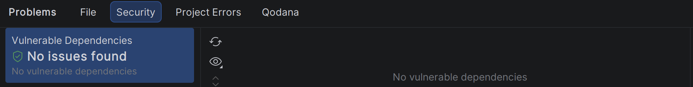
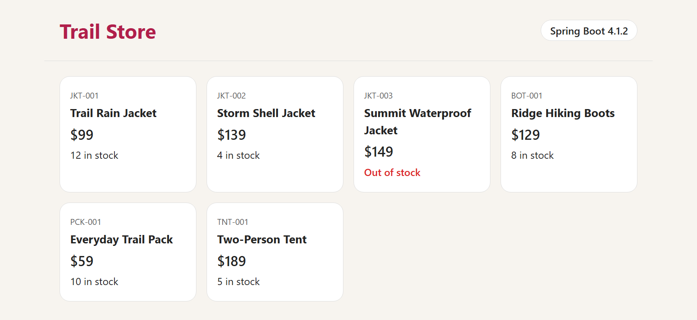

# Week 5 solution: An old app, a new home

How to solve [the challenge](README.md) with GitHub Copilot in IntelliJ IDEA.

## The steps

Open `05-app-modernization` in its own window, and install the **GitHub Copilot modernization** plugin, as in the README.

1. **See what's vulnerable.** Choose Code → Analyze Code → **Vulnerable Dependencies**. The Problems tool window opens on its **Security** tab: the old app has 25 issues. Click a library to see its CVEs.

   

2. **Turn on the plugin's tools.** In the chat box, click **Configure tools** (the sliders icon). Search for `appmod`, and make sure **appmod-mcp-server** is ticked. If it says **Stopped**, click **Start**. Then click **Apply**. With these tools, Copilot plans the upgrade, builds the app, runs the tests and checks for CVEs.

   

3. **Ask the upgrade agent.** Start a new chat, and choose the **modernize-java-upgrade** agent. Under the chat box, make sure it says **Copilot**, not **Local**. Then send:

   > Upgrade this app to Java 25 and the latest Spring Boot 4. Use the JDK 25 that's installed, move the tests to JUnit Jupiter without changing what they check, and upgrade any library with known CVEs.

   

   The **Upgrade Runtime & Frameworks** button in the tool window starts an upgrade too, but in a **Local** chat. With version 1.14.0 of the plugin, that chat stops at its first command, because the plugin stops IntelliJ's terminal from starting ([known issue](https://github.com/microsoft/github-copilot-appmod/issues/213)). The **Copilot** chat runs commands without IntelliJ's terminal.

4. **Check the plan.** Copilot writes an upgrade plan, `plan.md`, in `.github/modernize/java-upgrade/`: your guidelines, the goals, and each library's current and new version. Then it makes a branch, `appmod/java-upgrade-<id>`, and upgrades in steps, sometimes through Spring Boot 3.5 on the way. It builds the app after each step, and commits it.

   

   If Copilot tries to download another JDK for a step, and the download fails, tell it to use JDK 25 for every step.

5. **Read the summary.** At the end, Copilot checks the libraries for known CVEs, runs the tests, and writes `summary.md` next to the plan. In this run, the upgrade took about 8 minutes. Make sure the summary says the build and tests passed, and that the tests still check what they did before.

   

6. **Check the libraries yourself.** Click **Keep All**, press Ctrl+Shift+O to load the Maven changes, and run Vulnerable Dependencies again. Copilot's CVE check only looks at the libraries in `pom.xml`, so it misses the ones that Spring Boot brings in. In this run, 5 were left:

   

   Send, with the libraries that your check finds:

   > IntelliJ's Vulnerable Dependencies check still finds 5 vulnerable libraries that Spring Boot brings in: logback-classic, jackson-databind, json-smart, asm and android-json. Override each one with a version that fixes its CVEs, or exclude it if there's no fix, and keep the tests passing.

   

   Copilot pins fixed versions in `pom.xml`, and swaps android-json, which has no fix, for org.json. Click **Keep All**, press Ctrl+Shift+O, and run the check again.

   

7. **Run the store.** Run **StoreApplication** from the toolbar. http://localhost:8080 shows the six products, and Spring Boot 4.

   

## What you used

- **GitHub Copilot modernization**: its **modernize-java-upgrade** agent plans the upgrade, changes the code in steps, and builds and tests the app after each step. Its **appmod-mcp-server** tools do the planning, building, testing and CVE check. The plan, progress and summary are in `.github/modernize/java-upgrade/`.
- **Vulnerable dependencies**: IntelliJ's own check of your libraries, with data from Mend.io. It also finds the libraries that other libraries bring in.

## The code

Copilot's changes, after both prompts. Yours can differ: Copilot can pick other versions, or another fix for the same CVE. What matters is that the README's checks pass.

`pom.xml`:

```xml
<?xml version="1.0" encoding="UTF-8"?>
<project xmlns="http://maven.apache.org/POM/4.0.0"
         xmlns:xsi="http://www.w3.org/2001/XMLSchema-instance"
         xsi:schemaLocation="http://maven.apache.org/POM/4.0.0 https://maven.apache.org/xsd/maven-4.0.0.xsd">
    <modelVersion>4.0.0</modelVersion>
    <parent>
        <groupId>org.springframework.boot</groupId>
        <artifactId>spring-boot-starter-parent</artifactId>
        <version>4.1.2</version>
        <relativePath/>
    </parent>
    <groupId>com.contoso</groupId>
    <artifactId>trail-store-app-modernization</artifactId>
    <version>1.0.0</version>
    <name>Trail Store - Week 5: App modernization</name>
    <properties>
        <java.version>25</java.version>
        <jackson.databind.version>3.1.8</jackson.databind.version>
        <logback.classic.version>1.6.6</logback.classic.version>
        <json.smart.version>2.6.1</json.smart.version>
        <asm.version>9.11.1</asm.version>
        <org.json.version>20260814</org.json.version>
    </properties>
    <dependencyManagement>
        <dependencies>
            <dependency>
                <groupId>tools.jackson.core</groupId>
                <artifactId>jackson-databind</artifactId>
                <version>${jackson.databind.version}</version>
            </dependency>
            <dependency>
                <groupId>ch.qos.logback</groupId>
                <artifactId>logback-classic</artifactId>
                <version>${logback.classic.version}</version>
            </dependency>
            <dependency>
                <groupId>ch.qos.logback</groupId>
                <artifactId>logback-core</artifactId>
                <version>${logback.classic.version}</version>
            </dependency>
            <dependency>
                <groupId>net.minidev</groupId>
                <artifactId>json-smart</artifactId>
                <version>${json.smart.version}</version>
            </dependency>
            <dependency>
                <groupId>org.ow2.asm</groupId>
                <artifactId>asm</artifactId>
                <version>${asm.version}</version>
            </dependency>
        </dependencies>
    </dependencyManagement>
    <dependencies>
        <dependency>
            <groupId>org.springframework.boot</groupId>
            <artifactId>spring-boot-starter-web</artifactId>
        </dependency>
        <dependency>
            <groupId>org.springframework.boot</groupId>
            <artifactId>spring-boot-starter-thymeleaf</artifactId>
        </dependency>
        <dependency>
            <groupId>com.google.guava</groupId>
            <artifactId>guava</artifactId>
            <version>33.8.0-jre</version>
        </dependency>
        <dependency>
            <groupId>org.springframework.boot</groupId>
            <artifactId>spring-boot-starter-test</artifactId>
            <scope>test</scope>
            <exclusions>
                <exclusion>
                    <groupId>com.vaadin.external.google</groupId>
                    <artifactId>android-json</artifactId>
                </exclusion>
            </exclusions>
        </dependency>
        <dependency>
            <groupId>org.springframework.boot</groupId>
            <artifactId>spring-boot-starter-webmvc-test</artifactId>
            <scope>test</scope>
            <exclusions>
                <exclusion>
                    <groupId>com.vaadin.external.google</groupId>
                    <artifactId>android-json</artifactId>
                </exclusion>
            </exclusions>
        </dependency>
        <dependency>
            <groupId>org.json</groupId>
            <artifactId>json</artifactId>
            <version>${org.json.version}</version>
            <scope>test</scope>
        </dependency>
    </dependencies>
    <build>
        <plugins>
            <plugin>
                <groupId>org.springframework.boot</groupId>
                <artifactId>spring-boot-maven-plugin</artifactId>
            </plugin>
        </plugins>
    </build>
</project>
```

In `Catalog.java` and `StoreController.java`, `javax` becomes `jakarta`:

```diff
-import javax.annotation.PostConstruct;
+import jakarta.annotation.PostConstruct;

-import javax.servlet.http.HttpServletResponse;
+import jakarta.servlet.http.HttpServletResponse;
```

In `CatalogTest.java` and `StoreApplicationTests.java`, JUnit 4 becomes JUnit Jupiter, and `AutoConfigureMockMvc` moves to a new package:

```diff
-import static org.junit.Assert.assertEquals;
+import static org.junit.jupiter.api.Assertions.assertEquals;

-import org.junit.Test;
+import org.junit.jupiter.api.Test;

-import org.junit.runner.RunWith;
-import org.springframework.test.context.junit4.SpringRunner;
-@RunWith(SpringRunner.class)

-import org.springframework.boot.test.autoconfigure.web.servlet.AutoConfigureMockMvc;
+import org.springframework.boot.webmvc.test.autoconfigure.AutoConfigureMockMvc;
```